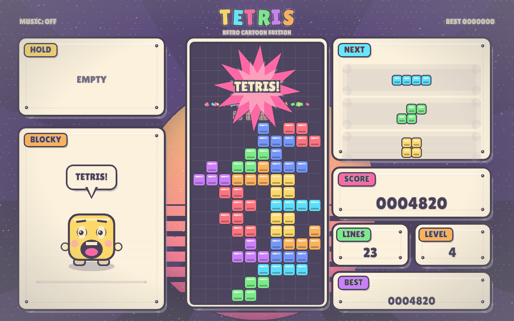

# TETRIS — Retro Cartoon Edition (Rust)

A complete Tetris game written in Rust with a modern cartoon art style and
NES-style chiptune audio. Everything is generated at runtime: the graphics are
drawn procedurally and the music/SFX are synthesized into WAV buffers at
startup, so there are no external audio files to ship.



## What it is

- **Rules:** SRS rotation with wall kicks, 7-bag randomizer, hold, ghost piece,
  guideline scoring, 500 ms lock delay with move resets, level speed curve,
  line-clear animation, block-out/lock-out game over.
- **Graphics:** "modern retro cartoon" — thick ink outlines, sticker panels with
  hard shadows, halftone sunset backdrop, comic bursts, confetti and a reacting
  mascot. Rendered with macroquad primitives; the only asset is an OFL display
  font.
- **Audio:** Korobeiniki (the public-domain folk tune used as the original NES
  Tetris Type A music) arranged for two pulse voices plus triangle bass at
  150 BPM, and NES-flavoured sound effects (move, rotate, lock, hard drop, hold,
  line clear, tetris fanfare, level up, game over).

## Build & run

Requires a Rust toolchain (tested with 1.98) and an audio device.

```sh
cargo run --release
```

If your environment cannot write to `~/.cargo` (some sandboxed setups), point
Cargo at a writable registry cache:

```sh
CARGO_HOME="$PWD/.cargo-home" cargo run --release
```

## Controls

| Key | Action |
| --- | --- |
| ← / → | Move (DAS/ARR) |
| ↓ | Soft drop |
| Space | Hard drop |
| ↑ / X | Rotate CW |
| Z / Left Ctrl | Rotate CCW |
| C / Left Shift | Hold |
| P / Esc | Pause |
| R | Restart |
| M | Music on/off |
| Enter | Start / play again |
| Esc (game over) | Back to menu |

On the menu, ←/→ (or ↑/↓) choose the starting level (1–15).

## Screenshot mode

For visual regression checks without touching the keyboard:

```sh
cargo run --release -- --shot out.png --screen play
cargo run --release -- --shot menu.png --screen menu
cargo run --release -- --shot pause.png --screen pause
cargo run --release -- --shot over.png --screen gameover
```

`--mute` disables audio. `--audio-check` loads the generated clips and prints
how many were decoded. `--dump-audio DIR` writes the synthesized music and SFX
as WAV files for inspection:

```sh
cargo run --release -- --dump-audio /tmp/tetris-audio
```

## Tests

```sh
cargo test
```

The suite covers the randomizer, SRS kicks, rotation integrity, line clears,
scoring, level progression, hold rules, lock delay, ghost, game over and a
randomised 4000-step play simulation, plus WAV header/audio sanity checks.

## Project layout

- `src/game.rs` — pure rules, deterministic RNG, unit tests (no window needed).
- `src/audio.rs` — WAV synthesis, Korobeiniki arrangement, SFX bank, tests.
- `src/render.rs` — cartoon renderer, mascot, particles, menus/overlays.
- `src/main.rs` — window, input/DAS, state machine, audio triggers, screenshots.

## Credits

- Korobeiniki: traditional Russian folk song, public domain.
- Lilita One font: SIL Open Font License 1.1 (`assets/OFL.txt`).
- [macroquad](https://macroquad.rs/) game framework (MIT/Apache-2.0).
